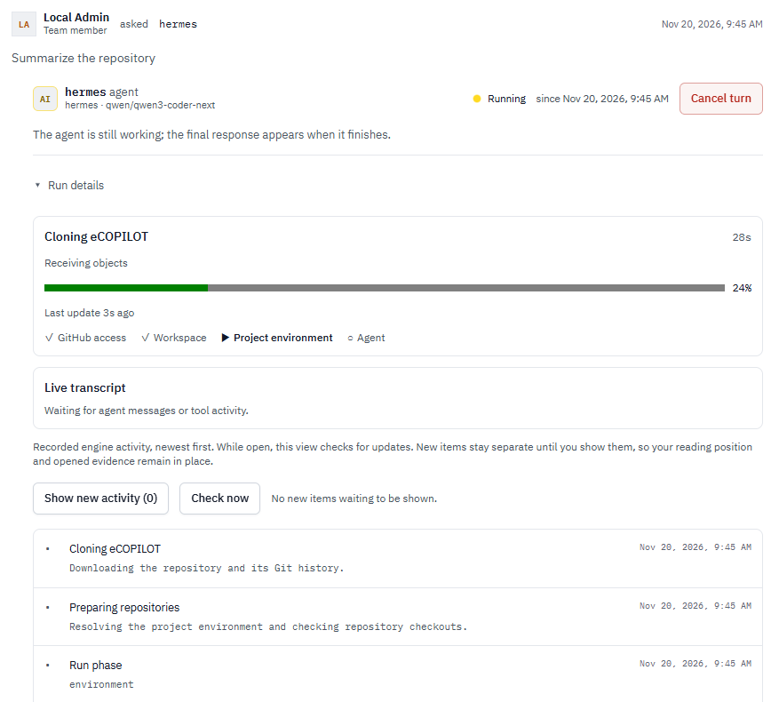
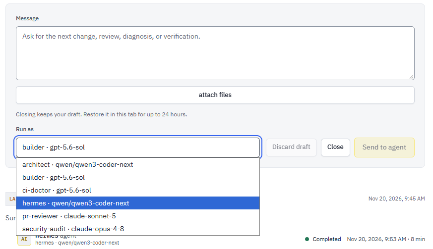
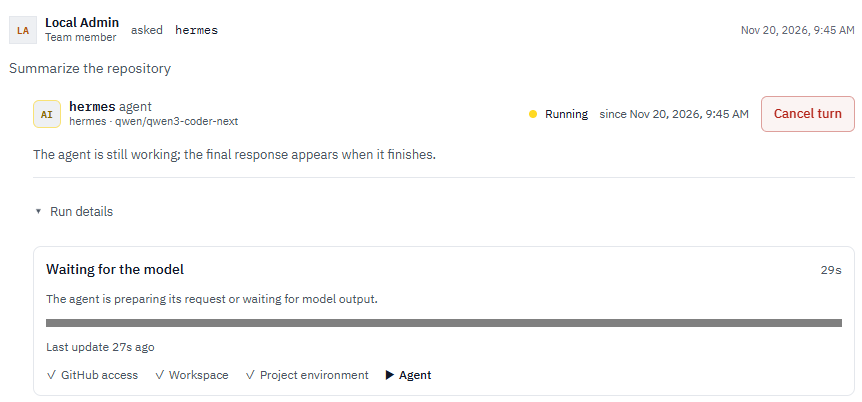
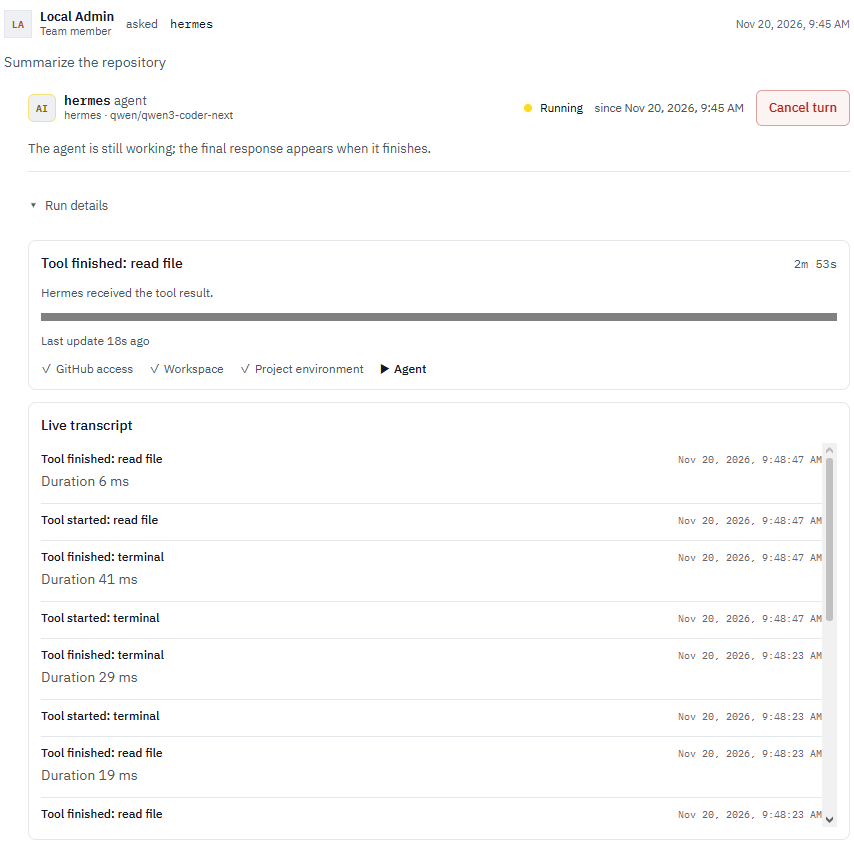
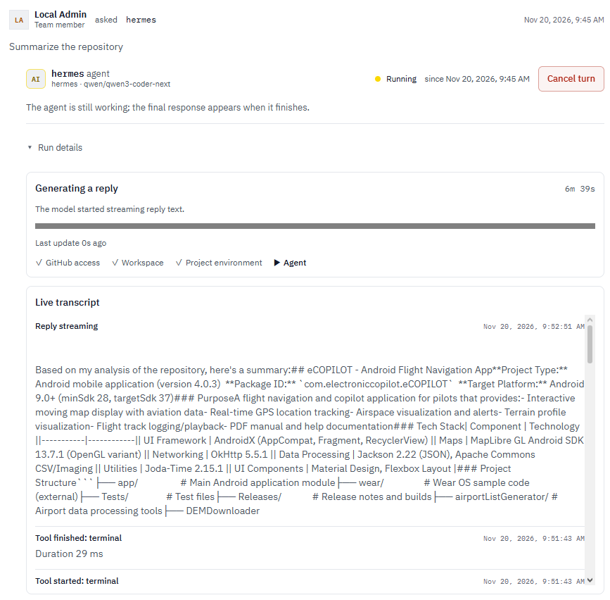
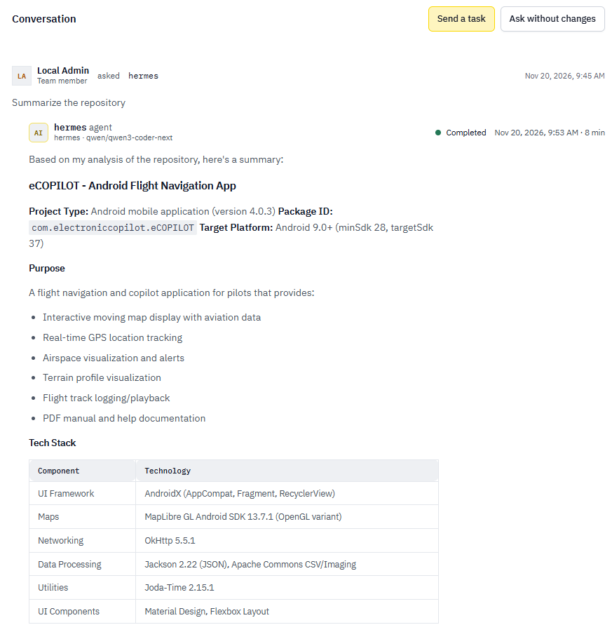
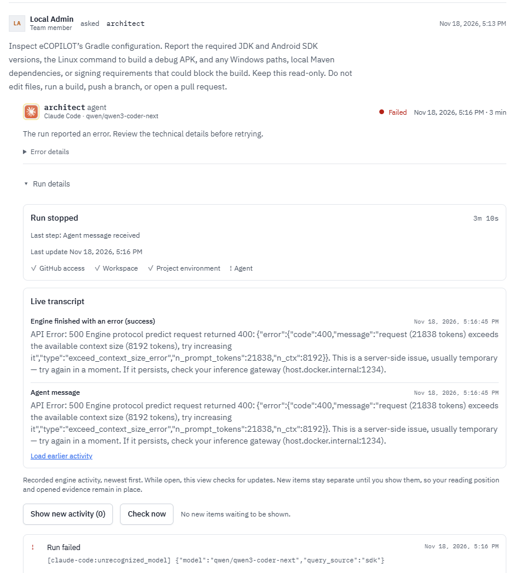

<div align="center">
  <picture>
    <source media="(prefers-color-scheme: dark)" srcset="assets/wordmark-dark.svg">
    
  </picture>
</div>

<p align="center">
  <a href="https://github.com/theam/facility/actions/workflows/ci.yml"></a>
  
  
</p>

# A persistent workspace for every story

Facility is an open-source, self-hosted platform for teams working with coding agents.
Each task keeps a shared conversation, a development environment, and a record of the changes made.
People and agents can continue the work, try the running application, and review the pull request.

We call that unit of work a **story**. Its files, dependencies, and engine sessions stay together
when an agent finishes or compute stops. The next turn continues in the same workspace.

[How it works](#how-the-work-moves) · [Run it locally](#quick-start-run-facility) ·
[Self-hosting guide](apps/docs/docs/self-host/quickstart.md) ·
[Security model](apps/docs/docs/reference/security.md)

## What's in this fork

This fork adds Hermes with LM Studio, expands the story run view, and fixes Windows
development startup. It builds on [upstream Facility](https://github.com/theam/facility).

| Change | What you can do |
| --- | --- |
| **Hermes with LM Studio** | Select a Hermes agent in a story and run it against a local model. Follow-up turns can resume the Hermes session in the same workspace. |
| **Run progress** | See which phase is active, how long it has been running, and when it last updated. Git clone and fetch show percentages when Git reports them. The agent phase shows activity such as waiting for the model, running a tool, or generating a reply. |
| **Live transcript and diagnostics** | Follow timestamped tool events and streamed reply text as the engine reports them. The transcript shows the newest entries first. Hermes, Claude Code, and Codex use this view, with details depending on the engine. Provider errors can surface here, including requests that exceed the model's context window. |
| **Windows startup** | Run `pnpm dev` from PowerShell. The launcher uses Node to invoke Corepack and finds the project's pinned pnpm for child processes. The worker uses a file URL comparison that handles Windows paths. |

### Run details in action



<details>
<summary>Hermes agent selection</summary>



</details>

<details>
<summary>Waiting for the model and tracking tool activity</summary>





</details>

<details>
<summary>Streaming and completed replies</summary>





</details>

<details>
<summary>Provider error details</summary>



</details>

### Start the fork on Windows

With Docker Desktop running, use Node.js 24 LTS and pnpm 11.28.2. For a fresh checkout,
run these commands in PowerShell:

```powershell
git clone --branch hermes-windows-updates https://github.com/javiersantoro/facility.git
Set-Location facility
pnpm dev
```

Open [the local Facility app](http://localhost:3400) once startup finishes. If you are
switching from another local Facility checkout, stop its dev server and copy its `.env`
to this checkout to keep the same local configuration. Existing PostgreSQL volumes
also retain checksums for applied migrations. If switching checkouts gives you a
`MigrationChecksumError` and the SQL differs only in line endings, restore the exact
SQL file bytes from the checkout that applied the migrations.

### Use Hermes with LM Studio

1. Load a model and start the local API server in LM Studio. Use an address the Docker
   workspace can reach, such as `http://host.docker.internal:1234/v1` with Docker Desktop.
2. From the Facility fork's root, build the base runner and its Hermes extension.

   ```powershell
   docker build -f runner/Dockerfile -t facility-runner:dev .
   docker build -f runner/Dockerfile.hermes -t facility-runner:hermes .
   ```

3. In the connected repository, set the workspace image to `facility-runner:hermes`
   and expose `HERMES_LM_STUDIO_URL` in `.facility.yml`. Add a manifest in `.agents/`
   with `engine: hermes` and the exact model ID reported by LM Studio.
4. Set the matching project-scoped URL and optional token in Facility's local `.env`.
   Restart Facility, open a new story, and select Hermes from **Run as**.

See [Hermes with LM Studio](apps/docs/docs/reference/agent-manifest.md#hermes-with-lm-studio)
for example manifests, environment variable names, and execution limits.

## Status

Facility is early software, built and used by The Agile Monkeys. We publish it so teams
can try the workflow, inspect the code, and help shape the product. APIs, database schemas, and
manifests evolve between `0.x` releases. Plan upgrades as explicit migrations with backups.

Start with one evaluation repository and follow the [security model](apps/docs/docs/reference/security.md)
when connecting code and credentials. Questions, bug reports, and focused pull requests help us
improve the next release.

## How the work moves

1. **Choose the work.** Start a story from a GitHub issue or an ad hoc request. Repository-defined
   agents can also respond to configured GitHub events and schedules.
2. **Continue with an agent.** Facility prepares the repository's development environment and runs
   the selected agent. People can steer the shared conversation, and later
   turns can use another agent in the same workspace.
3. **Check the running result.** Run the repository's tests and open an authenticated preview of
   its declared services. The preview uses the story workspace, including its current files and
   local data.
4. **Review and deliver through GitHub.** Agents use ordinary Git and GitHub commands to commit,
   push, and open pull requests. Required checks, reviews, and branch protection enforce your
   repository's merge policy.
5. **Keep the work available.** Merge marks the story done and suspends compute. Archive and suspend
   also retain the workspace. Only explicit workspace deletion removes its durable files and
   engine sessions.

The story timeline brings together messages, agent turns, Git changes, pull requests, reviews,
and checks. Project views expose recorded model and workspace costs, budgets, and operational
activity. MCP and the web application work with the same stories and lifecycle controls.

Two contracts live in your repository: [`.facility.yml`](apps/docs/docs/reference/project-manifest.md)
defines setup, services, and readiness; [`.agents/*.md`](apps/docs/docs/reference/agent-manifest.md)
defines agent instructions, engines, models, and triggers. The kickstart pull request creates both.
The project manifest also lets you [choose CPU and memory for new story workspaces](apps/docs/docs/reference/project-manifest.md#workspace-resources).

## Quick start: run Facility

You need Docker, Node.js 24 LTS, and pnpm 11.28.2. Node.js 22 is also supported
from 22.13.0. Start the application locally, then connect a repository to run
Claude Code, Codex, or Hermes in a story workspace.

### 1. Open the local application

```bash
git clone --branch hermes-windows-updates https://github.com/javiersantoro/facility.git
cd facility
corepack install --global pnpm@11.28.2
pnpm dev
```

Keep the terminal open. When the services are ready, visit
`http://localhost:3400` and choose **continue locally**. The API runs at
`http://localhost:4400` and the documentation at `http://localhost:3500`.

`pnpm dev` installs dependencies, prepares the local database, and starts the
services. It creates `.env` as needed and preserves existing values. The
[self-host quickstart](apps/docs/docs/self-host/quickstart.md) covers prerequisites,
health checks, and stopping and resuming the stack.

### 2. Prepare for your first repository

Build the image used by story workspaces:

```bash
docker build -f runner/Dockerfile -t facility-runner:dev .
```

Follow the [GitHub App guide](apps/docs/docs/self-host/github-app.md) to create
and install the App, configure its credentials, and bind the installation to
Facility. GitHub delivers events to a publicly reachable
`<PUBLIC_URL>/webhooks/github`; use a forwarding tunnel for local development.
The [authentication guide](apps/docs/docs/self-host/authentication.md) covers
GitHub and OIDC sign-in.

Configure credentials for your chosen engine using the
[project environment guide](apps/docs/docs/reference/project-manifest.md).
Restart `pnpm dev` after changing `.env`. The GitHub App supplies repository
access for cloning, pushing, and opening pull requests.

### 3. Connect, configure, and start a story

Create a project and select a repository visible to the GitHub App. Review the
detected setup command, development command, and service port. Open and merge
the kickstart pull request: it adds `.facility.yml` and the agent manifests in
`.agents/` so the environment and workflow are reviewed with your code.

Start a small story from the web application or MCP and select an agent that
accepts that trigger. Watch the conversation, open the service preview, then
suspend and continue the story. Your files and session should still be there.
That is your first complete workspace loop.

Use [story operations](apps/docs/docs/guides/operate-story.md) for the next task
and [end-to-end validation](apps/docs/docs/guides/validate-workspace-loop.md)
to check the full setup. The [CLI reference](apps/docs/docs/reference/cli.md)
covers creating the repository configuration from a terminal.

## Before connecting more repositories

Every agent receives maintainer-level access to the repositories and credentials connected to its
project. Each role defines instructions and triggers within that shared capability. Configure
protected branches, required CI, reviews, and GitHub App bypass settings to enforce your merge policy.

Self-hosting gives you control of the Facility services, database, and workspace storage. Claude
Code and Codex communicate with the model service you configure for the engine. Choose providers
and credentials that fit your infrastructure requirements.

Project budgets reserve a priced estimate before a turn or title-generation call. Measured
usage replaces the hold afterwards; an individual call can exceed its estimate. Interrupted
worker usage is recovered from retained per-turn journals where possible. Missing or incomplete
usage pauses new model calls while budget enforcement is enabled; see the
[deployment FAQ](apps/docs/docs/faq.md#does-a-project-budget-delete-or-stop-a-workspace).
Retained workspaces also need an explicit suspension, retention and deletion policy because storage
and provider resources have their own costs.

The [hardening guide](apps/docs/docs/reference/hardening.md) covers isolation, credentials,
backups, and retention. The [production guide](apps/docs/docs/self-host/production.md) covers
operating the instance.

## Documentation

| You want to… | Read |
|---|---|
| Understand the operating model | [AI SDLC method](apps/docs/docs/concepts/method.md) and [story loop](apps/docs/docs/concepts/the-loop.md) |
| Install and operate an instance | [Self-hosting](apps/docs/docs/self-host/quickstart.md), [authentication](apps/docs/docs/self-host/authentication.md), and [production](apps/docs/docs/self-host/production.md) |
| Configure a repository and its agents | [Project manifest](apps/docs/docs/reference/project-manifest.md) and [agent manifest](apps/docs/docs/reference/agent-manifest.md) |
| Continue, suspend, or archive work | [Story operations](apps/docs/docs/guides/operate-story.md) and [workspace lifecycle](apps/docs/docs/reference/lifecycle.md) |
| Find stories that need attention | [Project overview and attention queue](apps/docs/docs/guides/project-overview.md) |
| Connect a client or build an integration | [MCP tools](apps/docs/docs/reference/mcp.md), [REST API](apps/docs/docs/reference/api.md), and [webhooks](apps/docs/docs/reference/webhooks.md) |
| Check the whole setup on a repository | [End-to-end validation](apps/docs/docs/guides/validate-workspace-loop.md) |
| Find your way around the code | [Architecture](apps/docs/docs/reference/architecture.md) and [contributor guide](apps/docs/docs/contributors/architecture.md) |

## Contributing

Bug reports, documentation improvements, and focused feature proposals are welcome. Before
implementing a substantial change, open an [issue](https://github.com/theam/facility/issues) so its
behavior and boundaries can be agreed on.

```bash
git clone https://github.com/theam/facility.git
cd facility
corepack install --global pnpm@11.28.2
pnpm install --frozen-lockfile
pnpm verify
```

`pnpm verify` runs lint and type checks, a clean cache-disabled build, critical integration tests,
the remaining uncached tests, repository guards, and the dependency gate. CI separately builds the
self-host images and applies the Docker-backed workspace E2E policy documented in
[docs/testing.md](docs/testing.md).

Use a semantic branch name such as `docs/readme` or `fix/workspace-recovery`, keep the change to one
coherent intent, add tests for behavior changes, and include the commands you ran in the pull
request. See [CONTRIBUTING.md](CONTRIBUTING.md) and the [contributor
documentation](apps/docs/docs/contributors/architecture.md) for the complete workflow. Report
vulnerabilities through [SECURITY.md](SECURITY.md), not a public issue.

## License

Licensed under the [Apache License 2.0](LICENSE). Copyright 2026 The Agile Monkeys.

---

<p align="center">
  <br>
  <sub>An initiative by <a href="https://theagilemonkeys.com">The Agile Monkeys</a></sub>
</p>
